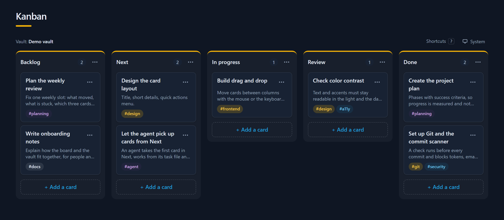

# Second Brain + Kanban

A local-first Kanban board whose cards are plain Markdown files, next to a Markdown "second brain" wiki that an AI agent
keeps. People, Obsidian and agents all read and edit the same files.



## What it is

A small system for working with an AI agent without losing control of it. It has two parts in one folder of Markdown files:

- **The board** (`Kanban.md` and `Tasks/`): what needs to be done, who is doing it, what waits for a human decision.
- **The wiki** (`raw/` and `wiki/`): what is known, compiled once from sources into linked pages and kept up to date.

Everything runs on your computer. There is no database, no cloud service and no account for the board and the vault.
The agent layer is written for Claude Code.

## Why

**Why cards that are files.** A card is an assignment. Its status is its column, and its details live in one task file,
so an agent gets the full context of a card from a single place and a person sees the same thing on the board.
The agent takes a card from "Next", writes the result into the task file and moves the card to "Review". Only a human
moves it to "Done". The human stays in the loop, and every step is a file you can read, diff and version.

**Why a wiki and not just memory.** Giving an agent a pile of notes is not enough. The wiki has rules:

- sources are kept apart from conclusions, so what a document says is never mixed with what you think about it;
- every claim links to its source, and when the sources do not say, the page says "unknown";
- a contradiction between two sources is marked, logged and left for a human to resolve, never fixed silently;
- secrets from exports (tokens, webhook URLs) are never copied into pages;
- a lint script checks links, the index, the log format and secrets, so the structure cannot quietly rot.

**Why Markdown on disk.** The format is open and works with Obsidian (and its Kanban plugin) or any editor.
The files are the integration layer: no API to depend on, nothing to migrate, and the whole history is in Git.

## Built to be cheap to run

The design picks the economical option at each step. These are design choices, not measured savings: token use per card
is not measured yet and is part of the plan.

- **No running costs for the board and the vault.** Local files, no database, no hosting, no paid service.
- **Compile once, reuse.** Sources are turned into wiki pages one time. Questions are answered from the index and a few pages,
  not by re-reading every raw document.
- **Small context at the start.** The session hook gives the agent only the last five sessions, the latest log entries and the
  open cards.
- **Plain code for mechanical checks.** The lint tool is a Python script with no model calls. The agent is only asked for
  judgment: contradictions and stale claims.
- **Routines do nothing when there is nothing to do.** Inbox, Reading and Runner check for new files or cards first and stop
  with one line when there are none. Lint runs once a week.
- **Small, bounded runs.** The runner takes one card per run, works one source at a time and stops when a task is unclear
  instead of guessing.

## How it works

1. **Capture.** A source (a job posting, an article, a workflow export) goes into `raw/`. It is never edited.
2. **Ingest.** The agent reads it and writes a source page, entity and concept pages, then updates the index and the log.
3. **Plan.** Work is cards on the board. Each card links to its task file.
4. **Run.** An agent takes the first card from "Next", works from the task file, writes the result and moves the card to "Review".
5. **Decide.** A human reads the result and moves the card to "Done", or sends it back.

```
raw/ source  ->  agent ingest  ->  wiki/ pages + index + log
                                         |
Kanban.md card -> task file -> agent run -> result in task file -> Review -> human -> Done
```

## Key features

1. **Board in the browser.** Five columns, drag and drop (mouse and keyboard), card editor, tags, light and dark theme,
   shortcuts that work on any keyboard layout.
2. **Edits from anywhere.** A change made in Obsidian, an editor or by an agent shows up on the board within two seconds,
   and the other way round. Writes are atomic and re-read the file first.
3. **Safe by default.** The server listens on `127.0.0.1` only. Deleted cards are archived, not erased.
4. **Hooks for the agent.** At session start the agent is given the last sessions, the latest log entries and the open cards.
   A stop hook refuses to end a session while the index or the log is out of date.
5. **Lint for the wiki.** Front matter, broken links, duplicate names, orphan pages, raw files never ingested,
   conflict marks without a log entry, secrets.
6. **Private data stays private.** Real notes live in a git-ignored folder. A pre-commit scanner blocks tokens, webhook URLs,
   email addresses, personal paths and private terms. The repository only contains a demo vault with invented data.

## Status

| Part | State |
|---|---|
| Board, Markdown storage, themes, shortcuts | Working. Unit, component and browser tests pass. |
| Wiki layer: schema, hooks, lint, demo vault | Working. Python tests pass. |
| Obsidian and the board editing the same files | Checked by hand with the Kanban plugin. |
| Agent runner (card from "Next" to "Review") | Worked end to end on one real card: result written into the task file, nothing else changed, human decides on "Done". One run only, tokens not measured, so no general claims. Details in [docs/PLAN.md](docs/PLAN.md). |

The plan with success criteria is in [docs/PLAN.md](docs/PLAN.md).

## Tech stack

Next.js (App Router), React, TypeScript, Tailwind CSS, dnd-kit, Vitest and Testing Library, Playwright, Node 22 or newer.
Python 3 (standard library only) for the hooks and the lint tool. Markdown and Git for everything else.

## Run

```
cd frontend
npm install
npm run dev        # http://localhost:3000, for development
```

On Windows, `start.cmd` builds the app when needed, starts it and opens the browser (close its window to stop).

Without any setup the app works on a throw-away copy of `sample-vault/` (kept in `.demo-vault/`, git-ignored).
To use your own vault, create `frontend/.env.local` (git-ignored):

```
VAULT_PATH=../vault-data
```

Set up your own vault (this never overwrites an existing file), then open the folder in Obsidian:

```
node scripts/init-vault.mjs vault-data
```

More: [docs/VAULT-FORMAT.md](docs/VAULT-FORMAT.md) (file format), [docs/SECOND-BRAIN.md](docs/SECOND-BRAIN.md) (wiki layer),
[docs/OBSIDIAN.md](docs/OBSIDIAN.md) (using the vault in Obsidian).

## Keyboard

The `T` key (or the button in the top right) switches between system, light and dark theme and remembers the choice.

| Key | Action |
|---|---|
| `N` | New card in the first column |
| `1` - `9` | New card in that column |
| `E` | Edit the card that has focus |
| `Space`, arrows, `Space` | Move the card that has focus |
| `T` | Change theme |
| `?` | Show the shortcuts |
| `Esc` | Close a window or a form |

## Tests

```
npm run test        # in frontend/: unit and component tests (Vitest)
npm run test:e2e    # in frontend/: browser tests (Playwright), on a copy of sample-vault
npm run lint        # in frontend/
python -m unittest discover -s tools/tests -t .    # hooks, lint tool, vault setup
```

## Origin

The board follows the Week 1 project brief of the course "AI Coder: From Vibe Coder to Agentic Engineer" by Ed Donner,
extended with Markdown storage and a second-brain layer. The code in this repository was written for it together with
Claude Code. It is released under the [MIT License](LICENSE).

## Repository

```
frontend/       Next.js board and the vault API
sample-vault/   example vault with invented data (schema, hooks, lint tool, routine prompts, demo wiki)
docs/           plan, file format, second-brain layer, Obsidian
scripts/        init-vault.mjs
tools/tests/    Python tests for the hooks, the lint tool and the vault setup
.githooks/      pre-commit scan for secrets and personal data
start.cmd       one-click start on Windows
```
